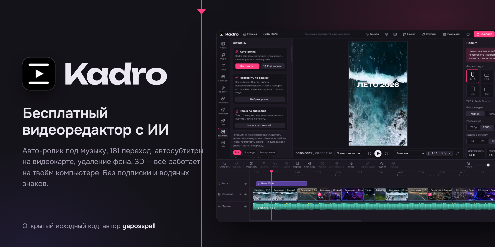

  

  
  
  
  
  

<h1 align="center">Kadro</h1>

<b>A free video editor for Windows with AI features that run right on your computer.</b> 
Editing for TikTok, Reels, Shorts and YouTube: blogger-style captions, cutting long videos into shorts, dubbing with translation, meme buttons, clone yourself, Auto Video to the beat, Script to Video, 181 transitions, 54 effects, 47 filters, shader plugins,
animated text, 3D objects, perspective, auto captions and offline caption translation, background removal, clean voice, 19 templates.
Export up to 4K with no watermark, no subscription and no sign-up.

<b><a href="https://github.com/honeyjostar/kadro/releases/latest">⬇ Download Kadro for Windows</a></b> — the installer is <code>Kadro-Setup-X.Y.Z.exe</code> under <b>Assets</b>. 
<a href="README.md">Русский</a> · <a href="https://t.me/kadroOffical">Telegram channel</a> · <a href="docs/BUILD.md">Building from source</a> (in Russian)

> [!IMPORTANT]
> The app is the installer on the Releases page. The green **Code → Download ZIP** button gets the source code for developers —
> there is no app in it.

The interface is available in **English and Russian**: Kadro picks the language of your Windows on first run, and you can switch it any time
in **Settings → Language**. The detailed guide ([docs/GUIDE.md](docs/GUIDE.md)) and plugin docs are in Russian for now; this page covers the essentials.

## Everything runs on your computer

Kadro is a regular desktop app, not a website. Your videos are never uploaded anywhere: editing, export and all AI tools run on your
CPU and graphics card. The internet is needed only once — to download a speech recognition model, a voice or a translation model the first
time you use it, and to check for updates (you can turn that off).

## What it can do

**New: for creators**
- **Blogger-style captions** — Hormozi, MrBeast, One word, Label, Neon, Karaoke: 1–3 words or a line, key words and numbers in color, emoji by meaning, pop-in words.
- **Cut into shorts** — a stream, podcast or vlog: Kadro listens to the speech, finds the most gripping moments and turns each into a vertical video — the frame follows the person, creator-style captions, a hook title.
- **Dubbing with translation** — Russian ⇄ English: recognizes the speech, translates it and voices it with another voice on the same timing, offline.
- **Swipe check** — Kadro watches the video like TikTok does and marks where viewers will leave (a quiet start, a long static shot, pauses, quiet sound); most come with a one-click fix.
- **Person as a separate layer** — text behind the person, a neon outline that flashes to the beat, and portrait mode with a blurred background.
- **Clone yourself** — you, twice in the frame: Kadro takes you from another moment of the video (or a second take) and puts you on top with the background removed.
- **Meme buttons** — dramatic zoom, to be continued…, bass boost, slow-mo with a boom; each with its own sound composed for Kadro.
- **Studio voice** in one click and **music quieter under voice in all projects**.
- Stickers (moving emoji), boomerang, color like another clip, sounds on cuts (whoosh, click, boom), an animated Subscribe button, a progress bar, your own logo in the corner.
- For beginners — **your first video in 3 steps**: Kadro shows what to click, from an empty project to a finished video.

**Auto Video and Script to Video**
- Choose videos, photos and music — Kadro finds the best parts (in focus, bright, steady, with motion — no freeze frames, shake or whip pans) and cuts them on the strong beats: it finds the downbeat, phrase starts and the **drop**; clips from different files are interleaved, flashes are rare and well placed; 10 styles including **Velocity**, Beat flash, 3D zoom and Text on the beat; “Another take”.
- **Repeat an edit from a video** (like CapCut templates): pick a video you like — Kadro finds its cuts, flashes and zooms, takes its music and puts your footage into the same slots.
- Paste a script — Kadro splits it into scenes, voices them (6 offline voices), picks shots from your footage and adds captions that match the text.

**Editing**
- Magnetic main track, overlays (picture in picture), text, music — as many tracks as you need; split, trim, reorder, multi-select.
- **Markers** (key M) with names and colors; they become YouTube chapters and chapters inside the exported MP4.
- Frame formats 9:16, 16:9, 1:1, 4:5, 3:4, 4:3, 21:9; resolution 720p–4K, 24–60 fps; opens almost any video, photo and audio file.
- **Collect project into a folder** with media, fonts and plugins — on another computer everything is found and installed by itself; **shortcuts window** (F1).
- Groups, keyframes, masks, chroma key with an **eraser and restore brush**, blend modes, perspective tilt and corner pinning, 3D objects (GLB, GLTF, OBJ, STL, FBX) — rotate them with the mouse, on the X/Y/Z axes, move, zoom, animate from one angle to another.
- Speed 0.25×–4× with pitch kept, speed curves, smooth slow motion with generated frames, reverse, freeze frame.

**Transitions, effects, color**
- 181 transitions, including 123 shaders from [gl-transitions](https://gl-transitions.com); 54 effects; 47 filters; curves, HSL, your own LUTs.
- **Plugin catalog** with live previews and one-click install; your own GLSL transitions and effects — drop a `.glsl` file into the window.

**Text, captions, sound, AI**
- 122 fonts plus **your own fonts** (drop `.ttf` / `.otf` into the window) and all Windows fonts; 13 text animations, karaoke word highlight.
- **Preview a track** before putting it on the timeline.
- Auto captions (Russian, English and 23 more languages), **offline caption translation** (Russian ⇄ English built in; to English, Russian, Ukrainian, German, Spanish,
  French, Italian, Chinese, Arabic — others via English), replacing the original or as two lines.
- **Subtitle files**: load `.srt` and `.vtt` (encoding detected automatically, including Windows-1251) and save captions to `.srt`.
- **Speech recognition on the graphics card** (NVIDIA, AMD, Intel via DirectML) or the processor — Auto compares both on your recording and picks the faster one.
- Background removal without a green screen, clean voice, remove pauses, stabilization, auto reframe, face retouch, text-to-speech.
- Voice recording, voice effects, beat detection and snapping cuts to the beat.

**Publishing**
- Safe zones for TikTok, Reels and Shorts in the player and a pre-publish check.
- MP4 (H.264), **GIF**, **MP3** (audio only) and **Telegram video sticker** (WebM 512 px, up to 3 s, transparent background) export, save the player frame as PNG (Shift+E); GPU encoding on NVIDIA (NVENC), AMD (AMF) and Intel (Quick Sync); Settings → Computer shows your GPU and why it doesn't encode, if it doesn't; autosaved drafts, `.kadro` projects.
- **Auto-update** and **Report a bug** (a ready GitHub issue with version and log — you see everything before sending).

## System requirements

- Windows 10 or 11, 64-bit
- 8 GB RAM (16 GB is better for 4K and background removal)
- About 1 GB of disk space plus optional AI models (speech recognition up to 0.5 GB, translation ~165 MB per direction)
- A graphics card is optional; NVIDIA (driver 570+), AMD and Intel speed up export

## Install

1. Download `Kadro-Setup-X.Y.Z.exe` from [Releases](https://github.com/honeyjostar/kadro/releases/latest).
2. Run it. If Windows shows “Windows protected your PC”, click **More info → Run anyway** (the installer has no paid code signature).
3. Kadro installs into `%LOCALAPPDATA%\Programs\Kadro` (no administrator rights needed) and adds shortcuts to the desktop and the Start menu.

The portable version is the `Kadro-X.Y.Z-portable.zip` file: unpack it anywhere and run `Kadro.exe`. The installed version updates itself.

## Quick start

1. Drop videos and photos into the window (or **Add files**).
2. Split with **S**, delete with **Delete**, drag clips to reorder.
3. On the left — text, captions, effects, transitions, filters, AI, templates, 3D. On the right — settings of the selected clip.
4. **Export** (Ctrl+E) — choose the quality and the folder.

| Key | Action |
|---|---|
| Space | play / pause |
| J / K / L | back / pause / forward; press again — faster (2×, 4×, 8×) |
| Shift+E | save the frame as an image (PNG) |
| S or Ctrl+B | split at playhead |
| Delete | delete selected |
| Ctrl+D | duplicate clip |
| Ctrl / Shift + click, Ctrl+A | select several clips / all |
| Ctrl+Z / Ctrl+Y | undo / redo |
| Ctrl+G / Ctrl+Shift+G | group / ungroup |
| Ctrl+Shift+C / Ctrl+Shift+V | copy / paste clip settings |
| ← → | by frame (with Shift — by second) |
| Home / End | to the start / end |
| M | marker at playhead |
| Shift+M / Ctrl+Shift+M | next / previous marker |
| Ctrl+wheel, + / − | timeline zoom |
| Ctrl+S / Ctrl+E | save project / export |

## Contributing

Found a bug or have an idea — **Settings → Help → Report a bug** in Kadro, or open an [issue](https://github.com/honeyjostar/kadro/issues).
Made a transition or effect? Send it to the [plugin catalog](community-plugins). Translations of the interface live in
[`src/shared/i18n/en.json`](src/shared/i18n/en.json) — improvements are welcome.

News and updates: [t.me/kadroOffical](https://t.me/kadroOffical).

## License

Kadro is free software under the **GNU GPL v3 or later** ([LICENSE](LICENSE)). Third-party components and models — [THIRD_PARTY.md](THIRD_PARTY.md).
