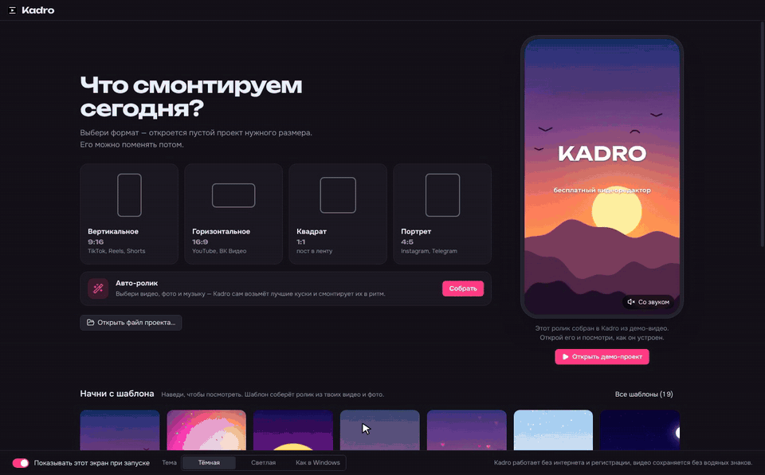
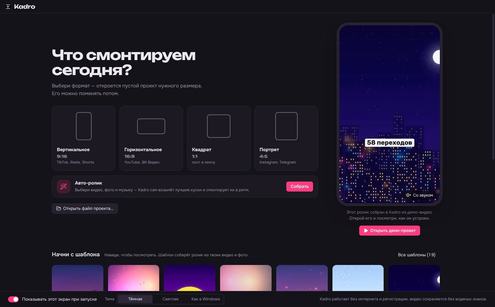
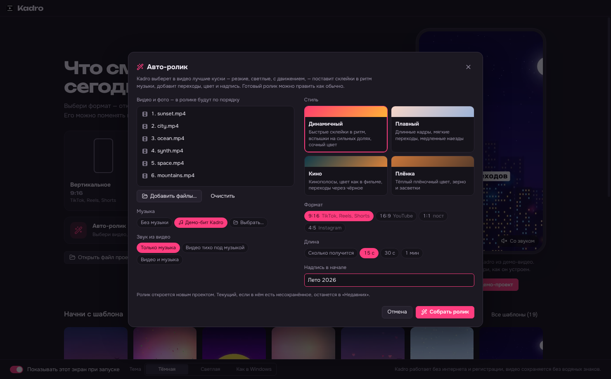
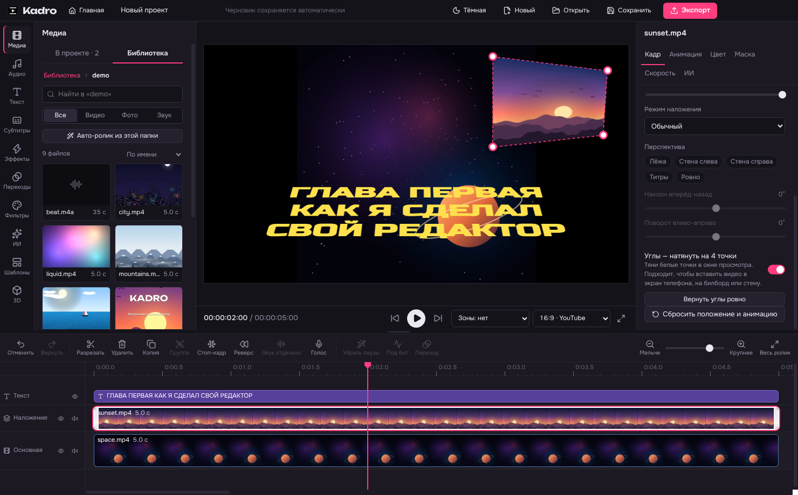
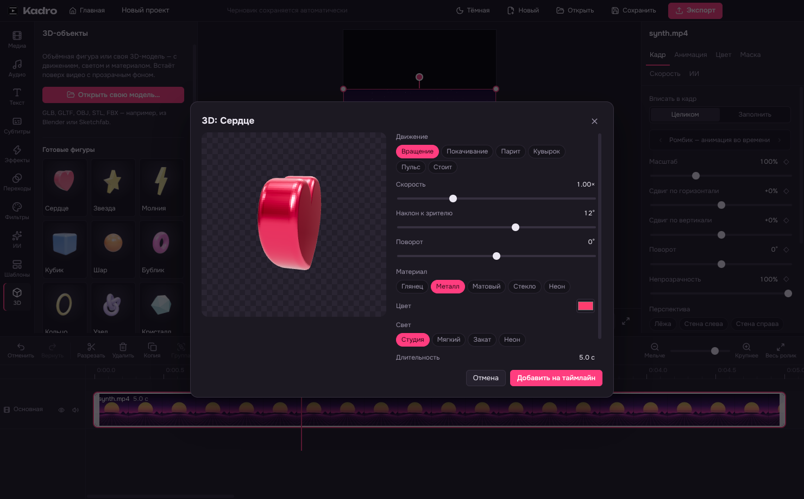
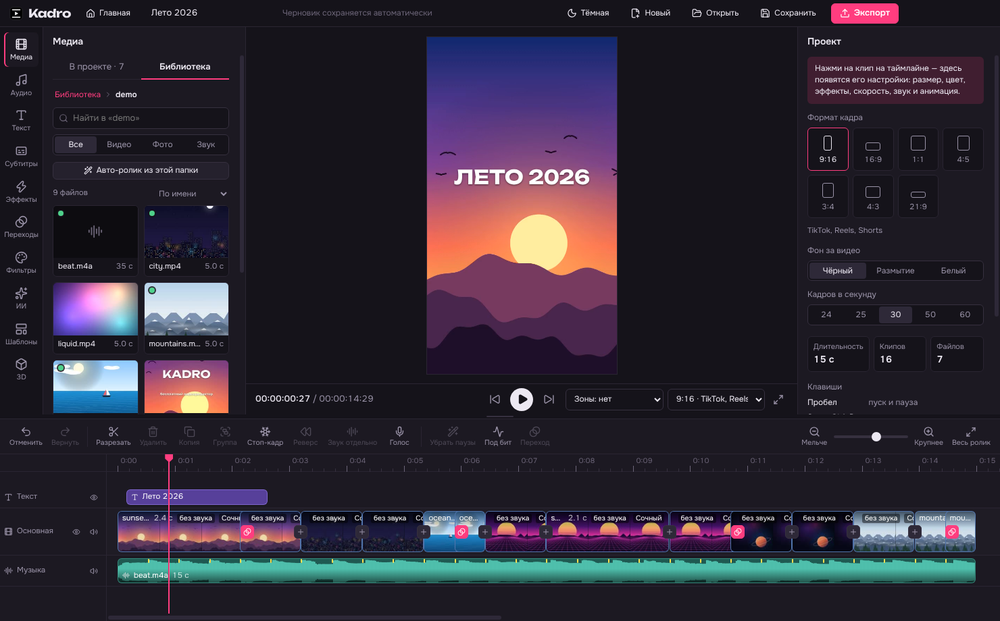
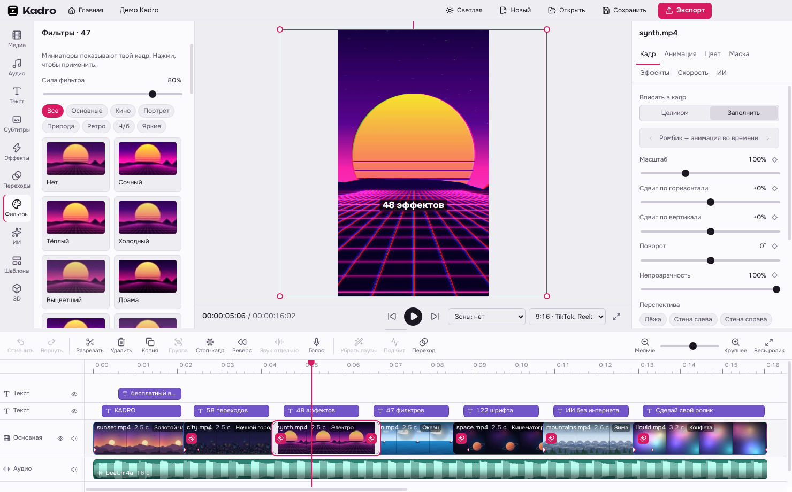

  

  
  
  
  

<h1 align="center">Kadro</h1>

<b>Бесплатный видеоредактор для Windows с ИИ-функциями, которые работают прямо на твоём компьютере.</b> 
Монтаж для TikTok, Reels, Shorts и YouTube: авто-ролик под музыку, 58 переходов, 48 эффектов, 47 фильтров, текст с анимацией,
3D-объекты, перспектива, автосубтитры, удаление фона, чистый голос, 19 шаблонов. Экспорт до 4K без водяных знаков, без подписок и регистрации.

  
  

Kadro 0.4.0 для Windows 10 и 11 · после установки занимает около 700 МБ ·
  <a href="docs/GUIDE.md">Руководство</a> · <a href="docs/BUILD.md">Сборка из исходников</a>

> [!IMPORTANT]
> Программа — это файлы по кнопкам выше. Зелёная кнопка **Code → Download ZIP** скачивает исходный код для программистов:
> программы там нет, а файлы `.ts` в нём — код на TypeScript, а не видео.

Авто-ролик: выбираешь видео, музыку и стиль — Kadro сам берёт лучшие куски и монтирует их в ритм. «Ещё вариант» — другой монтаж из тех же файлов.

---

## Всё работает у тебя

Kadro — обычная программа, а не сайт. Видео не загружаются ни на какие серверы: монтаж, экспорт и все ИИ-инструменты
выполняются процессором и видеокартой твоего компьютера. Интернет нужен только один раз — чтобы скачать модель
распознавания речи или голос для озвучки, когда ты впервые ими пользуешься (их раздают авторы моделей через GitHub).

## Что умеет

**Авто-ролик**
- Выбираешь видео, фото и музыку — Kadro находит в видео лучшие куски (резкие, светлые, с движением, без склеек внутри) и ставит склейки ровно на доли музыки
- 4 стиля: динамичный, плавный, кино, плёнка; формат, длина (15 с, 30 с, минута или «сколько получится»), надпись в начале
- «Ещё вариант» — другие куски и переходы из тех же файлов; готовый ролик правится как обычный монтаж

**Монтаж**
- Главный экран: новый проект нужного формата, недавние проекты, демо-проект, шаблоны с живым превью
- Основная «магнитная» дорожка, наложения (картинка в картинке), текст, музыка — сколько угодно дорожек
- Разрезать, обрезать, переставить, копировать, отменить / вернуть; привязка к кадрам, склейкам и долям такта
- Форматы кадра 9:16, 16:9, 1:1, 4:5, 3:4, 4:3, 21:9; фон — чёрный, белый или размытая копия видео
- Библиотека: папки со съёмками и музыкой добавляются один раз и видны в любом проекте, с поиском и превью
- Группы (составные клипы), плавные ключевые кадры для положения, размера, поворота и прозрачности
- Маски (линейная, зеркальная полоса, круг, прямоугольник) с растушёвкой, хромакей (зелёный фон), 6 режимов наложения
- Кнопки на таймлайне подписаны, у каждой — подсказка с клавишей; тёмная и светлая тема

**Переходы, эффекты, цвет**
- 58 переходов: растворения, сдвиги, шторки, круги, срезы, ветер, пиксели, сжатие
- 48 эффектов: движение (тряска, пульс, наезд, качание), свет (вспышка, стробоскоп, засветка, сияние), стиль (VHS, плёнка, глитч, нуар, киберпанк), кадр (зеркало, калейдоскоп, 2–9 экранов) и частицы (снег, дождь, конфетти, сердечки, блёстки, пузыри)
- 47 фильтров в разделах «Основные», «Кино», «Портрет», «Природа», «Ретро», «Ч/б», «Яркие» — миниатюры показывают твой кадр
- Кривые (общая и по каналам), HSL по 8 цветам, свои LUT-файлы (.cube)
- 10 анимаций появления и исчезновения клипа

**Перспектива и 3D**
- Наклон видео, фото и текста в перспективе (готовые: «лёжа», «стена слева / справа», «титры»)
- «Углы»: видео натягивается на 4 точки — вставить в экран телефона, на билборд или стену
- 3D-объекты: готовые фигуры или своя модель (GLB, GLTF, OBJ, STL, FBX) — с движением, материалом и светом, поверх видео с прозрачным фоном

**Скорость**
- Постоянная скорость 0.25×–4× с сохранением высоты голоса
- Кривые скорости: 6 готовых («Герой», «Пуля», «Монтаж»…) и своя
- Плавное замедление: недостающие кадры дорисовываются, а не повторяются
- Реверс и стоп-кадр

**Текст**
- 122 шрифта с кириллицей, обводка, тень, плашка, готовые стили
- 13 анимаций появления и исчезновения, печатная машинка, подсветка слов как в караоке

**Звук**
- Громкость, плавное появление и затухание, музыка на отдельных дорожках
- Запись голоса с микрофона прямо поверх видео; «Извлечь звук» из видео на отдельную дорожку
- Эффекты голоса: бурундук, великан, робот, эхо, зал, рация, телефон, мегафон
- Поиск ритма музыки и подгонка склеек под доли такта

**ИИ — без интернета и без подписки**
- Автосубтитры на русском и английском (слово в слово по времени, с правкой текста)
- Удаление фона с видео без зелёного экрана
- Чистый голос: убирает шум, гул и ветер; «Убрать паузы» вырезает тишину между фразами
- Стабилизация трясущегося видео
- Автокадрирование: вертикальный ролик из горизонтального, кадр следует за человеком
- Озвучка текста шестью голосами (русские и английские)
- Ретушь лица: сглаживание и осветление кожи

**Для TikTok, Reels и Shorts**
- В плеере видно, где интерфейс приложения закроет видео (кнопки, подпись, ник)
- Перед экспортом Kadro проверяет, не попал ли текст под интерфейс и не длиннее ли ролик, чем разрешает площадка

**Шаблоны и экспорт**
- 19 шаблонов (путешествие, день рождения, вечеринка, неоновая ночь, интро для YouTube…) и свои
- Экспорт MP4 (H.264) 720p, 1080p, 1440p, 4K, 24–60 кадров/с; на видеокартах NVIDIA — ускорение NVENC
- Автосохранение черновика, проекты `.kadro`

| Главный экран | Авто-ролик | Перспектива |
|---|---|---|
|  |  |  |
| **3D-объекты** | **Библиотека папок** | **Светлая тема** |
|  |  |  |

## Системные требования

- Windows 10 или 11, 64-бит
- 8 ГБ оперативной памяти (для 4K и удаления фона — лучше 16 ГБ)
- Около 700 МБ на диске для программы + место под модели ИИ (до 0.5 ГБ, скачиваются по желанию)
- Видеокарта не обязательна; NVIDIA ускоряет экспорт

## Установка

1. Скачай [**Kadro-Setup-0.4.0.exe**](https://github.com/honeyjostar/kadro/releases/download/v0.4.0/Kadro-Setup-0.4.0.exe) (212 МБ). Все версии — на странице [Releases](https://github.com/honeyjostar/kadro/releases/latest), в разделе **Assets**.
   Браузер может спросить, точно ли сохранить редко скачиваемый файл, — выбери «Сохранить».
2. Запусти. Windows может показать «Система Windows защитила ваш компьютер» — это потому, что у установщика нет платной цифровой подписи. Нажми **Подробнее → Выполнить в любом случае**.
3. Установщик ставит программу в `%LOCALAPPDATA%\Programs\Kadro` (около 700 МБ, права администратора не нужны) и создаёт ярлык **Kadro** на рабочем столе и в меню «Пуск» — по нему программа и запускается.

**Без установки:** скачай [Kadro-0.4.0-portable.zip](https://github.com/honeyjostar/kadro/releases/download/v0.4.0/Kadro-0.4.0-portable.zip) (292 МБ), распакуй в любую папку (хоть на флешку) и запусти `Kadro.exe` внутри.

**Обновление** — просто поставь новую версию поверх, проекты и настройки сохранятся.
**Удаление** — «Параметры → Приложения → Kadro → Удалить». Модели и черновики лежат в `%USERPROFILE%\.kadro`, эту папку можно удалить вручную.

## Быстрый старт

Быстрее всего — **«Авто-ролик»** на главном экране: выбери видео, фото и музыку, и через минуту готовый ролик. Вручную:

1. Перетащи видео и фото в окно (или «Добавить файлы»).
2. Режь клавишей **S**, удаляй **Delete**, переставляй мышью.
3. Слева — текст, субтитры, эффекты, переходы, фильтры, ИИ, шаблоны, 3D. Справа — настройки выделенного клипа.
4. **Экспорт** (Ctrl+E) — выбери качество и папку.

Подробно про каждую функцию — в [руководстве](docs/GUIDE.md).

### Клавиши

| Клавиша | Действие |
|---|---|
| Пробел | пуск / пауза |
| S или Ctrl+B | разрезать у курсора |
| Delete | удалить выделенное |
| Ctrl+D | копия клипа |
| Ctrl+Z / Ctrl+Y | отменить / вернуть |
| Ctrl+G / Ctrl+Shift+G | сгруппировать / разгруппировать |
| ← → | на кадр (с Shift — на секунду) |
| Home / End | в начало / в конец |
| Ctrl+колесо, + / − | масштаб таймлайна |
| Ctrl+S / Ctrl+E | сохранить проект / экспорт |

## Для разработчиков

Electron + React + TypeScript, экспорт через FFmpeg, ИИ — ONNX Runtime и sherpa-onnx. Превью и экспорт считаются по одним и тем же
формулам и проверяются автотестами кадр в кадр. Как запустить, протестировать и собрать установщик — в [docs/BUILD.md](docs/BUILD.md).

Нашёл ошибку или есть идея — открой [Issue](https://github.com/honeyjostar/kadro/issues).

## Лицензия

Kadro — свободная программа под лицензией **GNU GPL v3 или новее** ([LICENSE](LICENSE)): пользуйся, изучай, меняй и распространяй,
сохраняя ту же лицензию. Сторонние компоненты и их лицензии — в [THIRD_PARTY.md](THIRD_PARTY.md).

Автор — **yaposspall** ([@honeyjostar](https://github.com/honeyjostar)).
